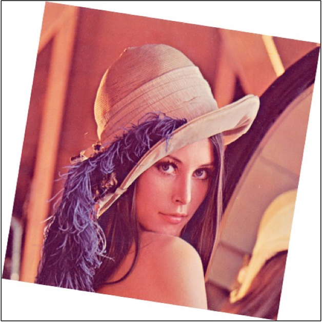
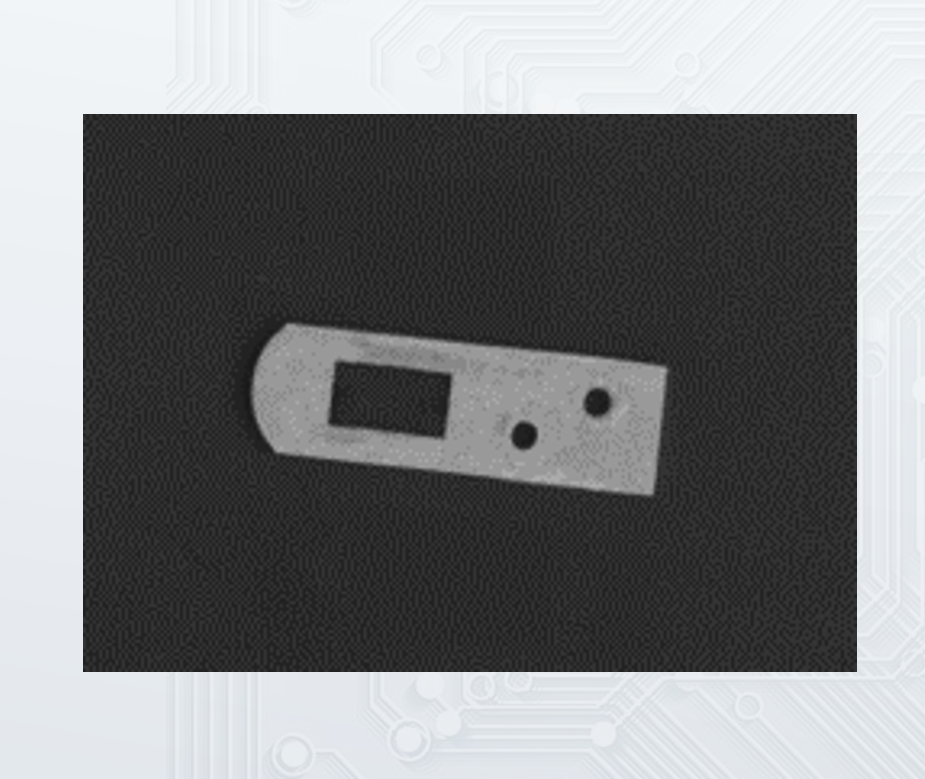
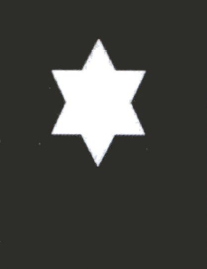
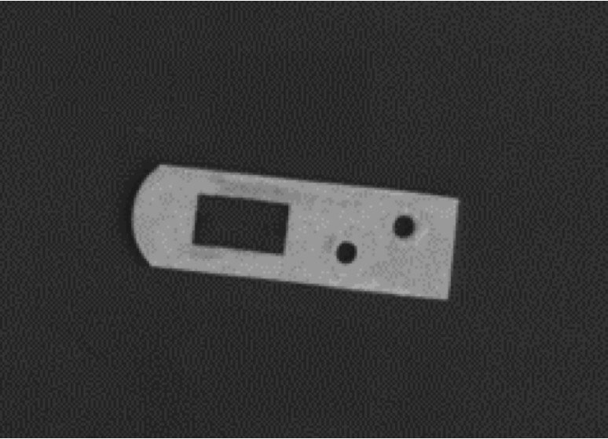
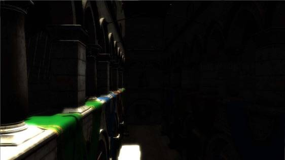
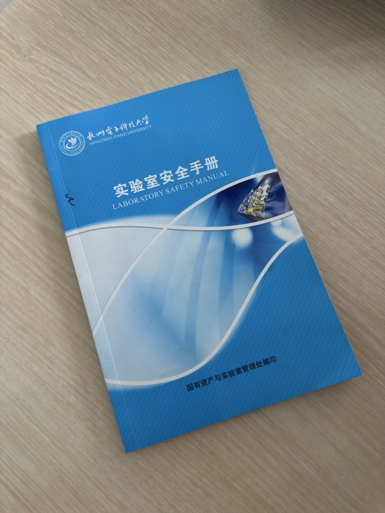
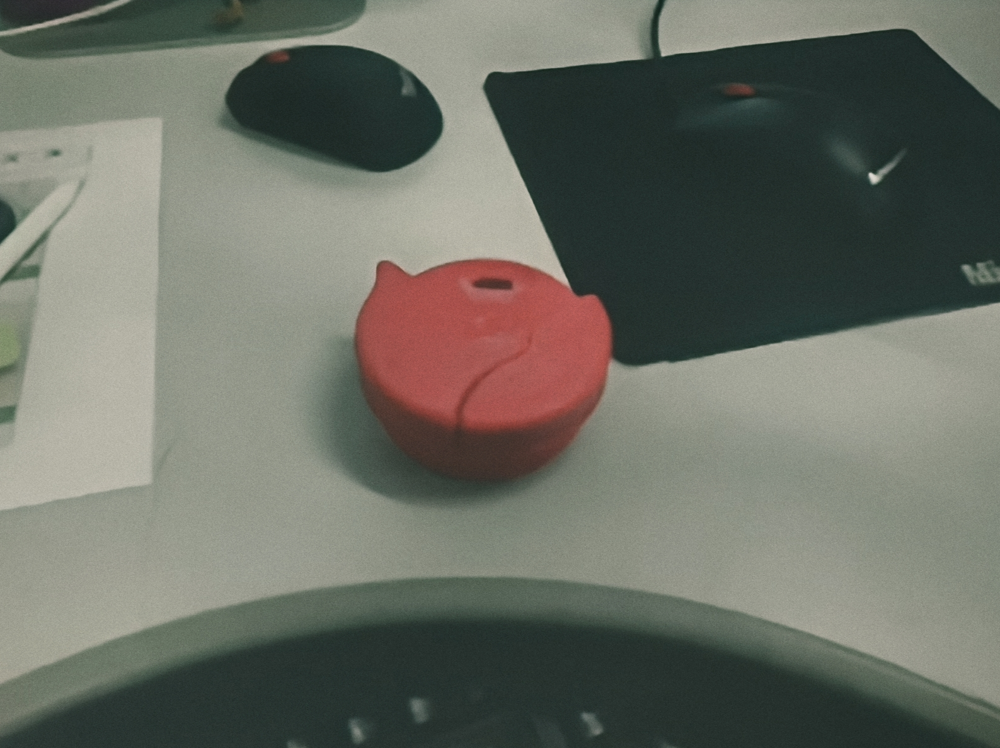

# OpenCV 测试图集

用于 OpenCV 图像处理算法的学习与测试。

### test0.jpg — 彩色图像处理

测试：颜色空间转换、灰度化、直方图均衡化、CLAHE。

### test1.png — 几何变换

测试：旋转、缩放、仿射变换、透视变换。

### test3.png — 图像去噪

测试：高斯滤波、中值滤波、双边滤波、非局部均值去噪。

### test4.png — 二值图像处理

测试：阈值分割、形态学操作、轮廓检测、形状识别。

### test5.png — 低对比度图像增强

测试：直方图均衡化、CLAHE、Gamma 校正、图像锐化。

### test7.png — 低照度图像增强

测试：Gamma 校正、Retinex、暗部细节增强、图像去噪。

### test8.jpg — 特征提取

测试：Canny 边缘检测、ORB/SIFT 特征提取、目标轮廓检测。

### test9.jpg — 颜色目标分割

测试：HSV 颜色分割、形态学去噪、轮廓提取、目标定位。
